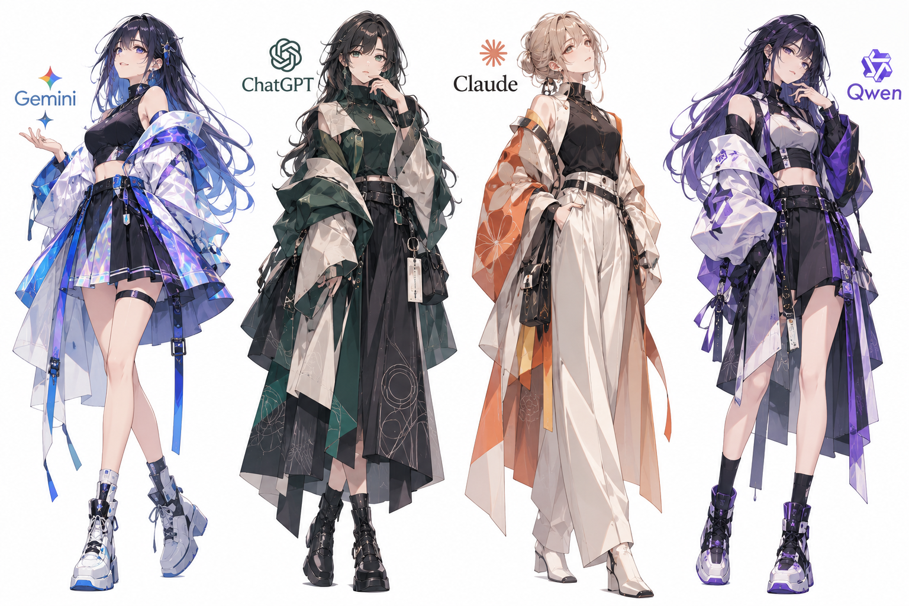

# Anime girls — LLM models



## Updated version

> Note: the Notion source ends mid-sentence in the ChatGPT section; the Claude and Qwen identities are missing.

````markdown
Create a high-end anime fashion editorial illustration featuring exactly four elegant, beautiful anime girls representing four popular large language models: **Gemini, ChatGPT, Claude, and Qwen**.

### Composition

- Strictly pure white background.
- Four full-body characters standing side-by-side, evenly spaced, with distinct silhouettes.
- Each character fully visible from head to toe, without overlapping.
- Cohesive visual identity across the collection, while preserving each model's unique personality and aesthetic.
- Integrate each LLM's name elegantly beside its corresponding character using refined fashion-editorial typography.

### Art Style

High-detail contemporary anime character design with polished digital rendering, expressive faces, elegant feminine silhouettes, and sophisticated Japanese fashion-editorial aesthetics.

Use soft, diffused lighting, delicate material rendering, and premium visual styling.

### Fashion Direction

Contemporary Japanese tech modernism:

- Minimalist Japanese street fashion and understated urban techwear.
- Refined layered outerwear, tailored silhouettes, and sophisticated garment construction.
- Subtle futuristic details, functional accessories, and innovative textiles.
- Wearable futuristic fashion rather than exaggerated sci-fi armour.
- Quiet luxury, understated cyber-minimalism, and elegant Japanese aesthetics.

### Character Identities

**Gemini — Multimodal Futurist**\
A brilliant, forward-looking character with a sleek, innovative silhouette. Use a palette inspired by Gemini's blue, purple, and cool cyan identity. Incorporate iridescent accents, geometric layering, and subtle star-like motifs.

**ChatGPT — Thoughtful Innovator**\
A composed, intelligent character with balanced proportions and versatile, elegant styling. Use deep green, charcoal, and soft ivory. Incorporate subtle interwoven patterns and refined circular motifs inspi
````

## Original version

````markdown
create an image of four cute modern techwear minimalism anime girls in digital character design style on white background each posing in a way that matches their aesthetic where each character is one of the top ai labs rn based on which models from which labs are the best models rn and put them in order theyre ranked by which has the best model rn
````
