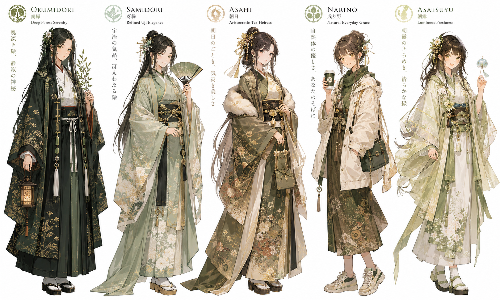

# Anime girls — Matcha cultivars



````markdown
create an image of five elegant beautiful anime girls in high-detail digital character design style on white background standing side-by-side evenly, each girl representing a premium Japanese matcha cultivar from the same refined tea house shrine aesthetic, blending historical Japanese shrine maiden fashion, yukata and kimono elements, contemporary Japanese daily fashion, and subtle modern outerwear styling, harmonious muted greens and earthy colour palettes, stylised anime fashion, atmospheric elegant mood, refined Japanese aesthetics, soft luxury fashion editorial feeling

Okumidori: calm mature shrine maiden, deep forest greens, layered haori, mysterious elegance

Samidori: refined Uji noblewoman, ceremonial kimono details, graceful posture, soft jade palette

Asahi: aristocratic tea heiress, luxurious muted fabrics, poised expression, Kyoto heritage aesthetics

Narino: gentle approachable beauty, soft earthy tones, casual modern outerwear, warm smile

Asatsuyu: luminous youthful elegance, fresh moss palette, airy sleeves, serene cheerful atmosphere
````
