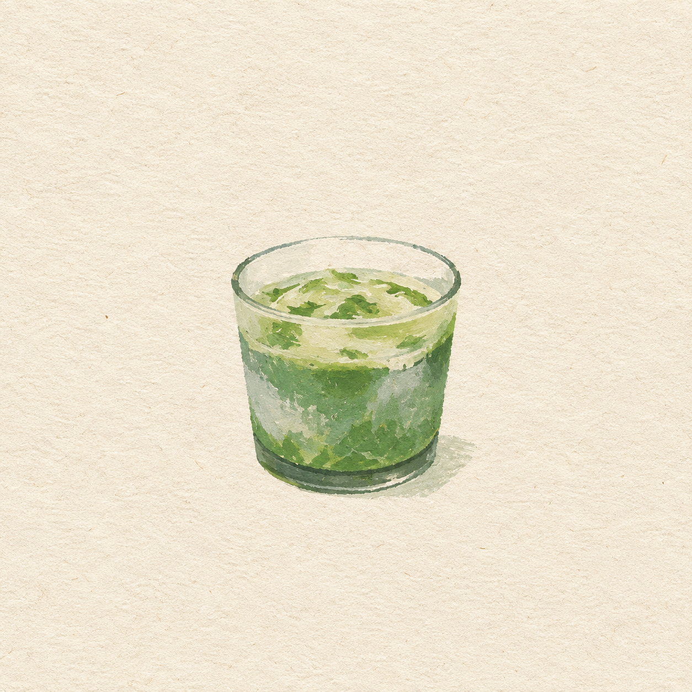

# Hand-drawn paper illustration

Upload a reference photo with this prompt.



````markdown
Create a single standalone square illustration based directly on the provided reference image.

FORMAT

Strict 1:1 square composition.

Use the uploaded photograph only as the visual reference.

Do NOT create a poster.
Do NOT create a split composition.
Do NOT include the original photograph.
Do NOT recreate the top-half photographic section.
Do NOT add any text, typography, title, labels, letters, numbers, logos, or captions.

The entire canvas must be the hand-drawn paper illustration.

CORE CONCEPT

Reinterpret the most recognisable visual elements of the reference photograph as a small, minimalist, hand-drawn paper illustration.

The illustration should feel like a quiet independent art-book image or a small handmade visual poem.

The goal is not to reproduce the photograph realistically.

Instead, reduce the photograph into its simplest recognisable visual language while preserving the identity of the main objects, their essential proportions, arrangement, and visual relationship.

SUBJECT AND COMPOSITION

Identify the most important and recognisable objects in the reference image.

Preserve:

- The primary subject
- Essential silhouettes and proportions
- Important secondary objects
- The recognisable arrangement between objects
- The main spatial relationship
- The most distinctive visual characteristics of each object

Simplify aggressively.

Remove:

- Unnecessary photographic detail
- Fine surface detail
- Realistic reflections
- Complex shadows
- Excessive texture
- Background clutter
- Small incidental objects
- Photographic realism

The resulting illustration should remain immediately recognisable as a simplified interpretation of the reference photograph.

COMPOSITION

Keep the main illustrated subject relatively small and centred.

The subject should occupy approximately 10–20% of the total square canvas.

Surround it with a large amount of quiet negative space.

The composition should feel intentionally sparse, balanced, calm, and slightly imperfect.

Do not enlarge the subject simply to fill the canvas.

The empty space is an important part of the composition.

HAND-DRAWN PAPER STYLE

Create the image as a genuine handmade paper illustration.

Use:

- Delicate, slightly imperfect hand-drawn contours
- Organic, irregular edges
- Visible handmade brush marks
- Rough natural paper texture
- Subtle paper fibres and grain
- Slight variations in pigment density
- Small imperfections in the printed or painted shapes
- Simple acrylic-like flat colour shapes
- Sparse hand-painted marks
- Slightly uneven edges and contours
- A tactile analogue printmaking / handmade-paper quality

The artwork should feel physically made by hand on textured paper rather than digitally generated.

Use a restrained combination of simple shapes and delicate drawn marks.

The illustration should have a sophisticated handmade quality, similar to an independent art publication, contemporary children's picture book, or experimental Japanese paper illustration.

IMPORTANT STYLE DISTINCTION

This is NOT a polished digital illustration.

This is NOT realistic painting.

This is NOT a detailed illustration.

This is NOT pure line art.

The image should sit between:

minimal hand drawing
+
flat hand-painted colour shapes
+
rough natural paper

Keep the visual language simple, tactile, quiet, and intentionally imperfect.

BACKGROUND

Use a predominantly warm natural paper background.

Possible appearance:

- Warm off-white
- Ivory paper
- Pale cream
- Natural unbleached paper
- Very light warm grey paper

The background should contain substantial uninterrupted negative space.

Only use a few subtle marks to suggest the environment from the original photograph when necessary.

Do not recreate the entire photographic background.

The background should remain visually quiet.

COLOUR PALETTE

Extract the dominant colours directly from the reference photograph.

Reduce the entire illustration to a maximum of 4 main colours.

Use restrained, sophisticated, harmonious colours.

Prioritise the most characteristic colours from the original image.

Use colour as simple flat or semi-flat painted shapes rather than realistic shading.

Avoid gradients and excessive colour variation.

Allow small natural variations in pigment and brush coverage to maintain the handmade appearance.

RECOGNITION

The illustration must remain strongly connected to the reference photograph.

Even though the image is highly simplified, the viewer should be able to recognise the original subject and arrangement.

Prioritise:

1. Recognition
2. Essential silhouette
3. Object relationships
4. Composition
5. Colour identity
6. Handmade material quality

Do not sacrifice recognition for decorative abstraction.

LIGHT AND SHADOW

Do not reproduce realistic photographic lighting.

Instead, reduce important light and shadow information into a few simple hand-painted shapes where useful.

Keep shadows subtle and graphic.

Avoid realistic rendering.

AVOID

Do not use:

- Text
- Typography
- Letters
- Numbers
- Logos
- Captions
- Poster titles
- Watermarks
- Coloured-pencil aesthetics
- Crayon textures
- Bleeding watercolor
- Soft watercolor washes
- Pure line-art
- Detailed realistic illustration
- Photorealism
- Heavy oil painting
- Smooth polished digital painting
- 3D rendering
- Glossy surfaces
- Plastic textures
- Commercial cartoon aesthetics
- Cute commercial character design
- Anime aesthetics
- E-commerce aesthetics
- Generic illustration templates
- Decorative borders
- Excessive background elements
- Excessive texture
- Busy compositions
- Excessive colours
- Unnecessary objects

FINAL ART DIRECTION

A minimalist square hand-drawn paper illustration derived directly from the provided photograph.

Small recognisable subject.

Large amount of negative space.

Warm natural paper.

Maximum 4 restrained colours.

Simple acrylic-like flat colour shapes.

Delicate imperfect hand-drawn marks.

Visible handmade brush texture.

Organic irregular edges.

Quiet, poetic, refined, innocent, relaxed, artistic, thoughtful, and premium.

The final image should feel like a tiny handmade visual poem on a sheet of beautiful art paper — a simplified interpretation of the reference photograph, not a recreation of the photograph itself.
````
